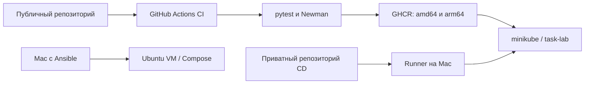

# Kubernetes Delivery Lab

Учебный DevOps-проект: контейнеризация HTTP API, проверка изменений в CI,
публикация multi-platform образов и доставка в Kubernetes. Дополнительный
Ansible-сценарий подготавливает Ubuntu VM и запускает API через Docker Compose.

Проект предназначен для локального обучения и демонстрации инфраструктурных
решений. Приложение — небольшая демонстрационная нагрузка, а не production-сервис.

## Стек

Python 3.14, FastAPI, Docker, Docker Compose, Kubernetes/minikube,
GitHub Actions, GHCR, Ansible, pytest, Postman Collection v2.1, Newman 6.2.1.
Thanos, Vault, Terraform и Qbec в этом проекте не реализованы.

## Как устроен стенд



- CI проверяет приложение и собирает образы после push в `develop`/`main`.
- CD запускается вручную в отдельном приватном репозитории: принимает SHA,
  проверяет успешный CI, обновляет Deployment и запускает HTTP-тесты.
- Ansible — альтернативный способ установки на Ubuntu, а не часть Kubernetes.
- Самостоятельный локальный запуск **не требует** доступа к авторским секретам,
  GHCR или приватному репозиторию CD. Базовые образы и зависимости скачиваются
  из публичных источников; интернет нужен при первом запуске.

## Быстрый запуск через Compose

Нужны Git, работающий Docker с Compose v2. Node.js/npm нужен только для Newman,
Python на хосте — для pytest и вспомогательных скриптов.

```bash
git clone https://github.com/Chernomor-Tactics/k8s-delivery-lab.git
cd k8s-delivery-lab
git switch develop
docker compose up -d --build --wait
curl -i http://127.0.0.1:8001/health
curl -i http://127.0.0.1:8001/version
```

Ожидаемые ответы: `{"status":"ok"}` и `{"version":"0.1.0"}`.
Swagger UI: <http://127.0.0.1:8001/docs>.
Если порт занят: `APP_PORT=8005 docker compose up -d --build --wait`.

```bash
docker compose logs --tail=50 api
docker compose down
```

## Проверки

```bash
python3 -m venv .venv
source .venv/bin/activate
python -m pip install -r requirements-dev.txt
python -m pytest tests/unit -v
bash scripts/smoke-test.sh http://127.0.0.1:8001 0.1.0
npx --yes newman@6.2.1 run tests/postman/task-api.postman_collection.json \
  --env-var base_url=http://127.0.0.1:8001 --timeout-request 5000 --bail
```

В `tests/unit` находятся 8 API-тестов через FastAPI TestClient (внутри процесса,
без реального HTTP-сервера). Коллекция выполняет 7 последовательных HTTP-запросов,
создаёт собственную задачу и удаляет её. `base_url` можно менять для каждого стенда.
Newman устарел по актуальной документации Postman; здесь он закреплён для учебной
совместимости с форматом v2.1. Коллекции v3 для этого запуска не подходят.

## Kubernetes без GHCR и секретов

Нужны Docker, kubectl, minikube и Python 3. Этот сценарий использует отдельный
namespace `task-lab-local` и не меняет окружение `task-lab`, которым управляет CD.

```bash
minikube start -p minikube
bash scripts/deploy.sh
```

Скрипт собирает образ с тегом по содержимому исходников, загружает его в minikube,
применяет локальную конфигурацию и ждёт готовности. Для другого профиля:
`MINIKUBE_PROFILE=my-lab bash scripts/deploy.sh` (профиль должен уже работать).

В отдельном терминале:

```bash
kubectl --context=minikube -n task-lab-local port-forward service/task-api 8002:80
```

Затем:

```bash
bash scripts/smoke-test.sh http://127.0.0.1:8002 local
npx --yes newman@6.2.1 run tests/postman/task-api.postman_collection.json \
  --env-var base_url=http://127.0.0.1:8002 --timeout-request 5000 --bail
```

Просмотр конфигурации: `kubectl kustomize k8s-local`. Kustomize встроен в kubectl;
он лишь убирает registry Secret и меняет образ/namespace у основных манифестов.

Удаление **только локального тестового окружения** (задачи в памяти пропадут):

```bash
kubectl --context=minikube delete -k k8s-local
```

## Ansible и Ubuntu VM

Проверенный сценарий — Ubuntu 24.04 с Python 3, SSH и пользователем с sudo.
Ansible запускается с Mac/Linux, выполняет задачи на VM. Inventory и ключи свои.

```bash
python3 -m venv .venv-ansible
.venv-ansible/bin/python -m pip install ansible
.venv-ansible/bin/ansible-galaxy collection install -r ansible/requirements.yml
cp ansible/inventory.example.ini ansible/inventory.ini
```

Замени IP и путь к SSH-ключу в `ansible/inventory.ini`. Подробный способ создания
VM через Multipass и добавления ключа: [пошаговая инструкция](docs/walkthrough.md).

```bash
.venv-ansible/bin/ansible app_servers -i ansible/inventory.ini -m ansible.builtin.ping
.venv-ansible/bin/ansible-playbook -i ansible/inventory.ini ansible/playbook.yml --syntax-check
```

### Из исходников без GHCR

```bash
.venv-ansible/bin/ansible-playbook -i ansible/inventory.ini \
  ansible/playbook.yml -e deployment_mode=source
```

Playbook устанавливает Docker/Compose, копирует исходники API и Dockerfile,
генерирует Compose, собирает образ **на Ubuntu** и проверяет health/version.
VM должна иметь доступ к публичному Python-образу и PyPI. Ответ версии — `local`.
При добавлении новых файлов приложения дополни список копирования в playbook.

### Из приватного GHCR

По умолчанию сохранён авторский registry-сценарий. Для собственного registry
переопредели `registry_repository`, `registry_username` и `release_sha`.
Токен должен иметь доступ к соответствующему пакету (`read:packages`).

```bash
export GHCR_TOKEN="$(gh auth token)"
.venv-ansible/bin/ansible-playbook -i ansible/inventory.ini \
  ansible/playbook.yml -e deployment_mode=registry
unset GHCR_TOKEN
```

При необходимости сначала авторизуй GitHub CLI и выдай ему `read:packages` через
`gh auth refresh -h github.com -s read:packages`. Токен не записывается в репозиторий;
авторизация Docker сохраняется у root на VM, параметры задачи скрыты `no_log`.

Повтори выбранную команду: при неизменном состоянии ожидается `changed=0`,
`failed=0`, `unreachable=0`. Обновление кеша apt после часа может учитываться как
изменение; это не обязательно повторный деплой приложения.

```bash
curl http://VM_IP:8080/health
curl http://VM_IP:8080/version
```

`app_port`, `app_directory`, `app_project_name`, `app_image`, `app_version` можно
переопределять через `-e`. Compose на VM публикует порт на её интерфейсах;
доступность с Mac зависит от сети VM.

## CI и CD

CI: [`.github/workflows/ci.yml`](.github/workflows/ci.yml).
Он проверяет синтаксис Ansible и shell-скриптов, выполняет pytest, Compose и Newman, затем публикует сборки `linux/amd64` и
`linux/arm64` в `ghcr.io/<owner>/<repository>:sha-<full-commit-sha>`.
В pull request выполняются проверки, публикация не запускается.

Публичный проект можно запускать без CD. Описание CD и пример workflow:
[docs/cd.md](docs/cd.md). Локальный runner подключён к отдельному приватному
репозиторию. Файл токена регистрации, kubeconfig и registry Secret в Git не входят.

## API

| Метод | Путь | Результат |
|---|---|---|
| GET | `/health` | Готовность приложения |
| GET | `/version` | Заданная версия |
| POST | `/tasks` | Создать задачу, 201 |
| GET | `/tasks` | Список задач |
| GET | `/tasks/{id}` | Задача или 404 |
| DELETE | `/tasks/{id}` | Удалить, 204, либо 404 |

## Ограничения

- Один процесс и одна реплика: задачи хранятся в памяти и теряются при перезапуске.
- Kubernetes использует `Recreate`: обновление с простоем, HA не реализована.
- `/health` не проверяет внешние зависимости (их у API нет).
- CD обновляет существующий стенд, не создаёт кластер и Secret автоматически.
- Автоматического отката нет; неудачный деплой завершает workflow ошибкой.
- SHA-теги используются по соглашению; защиту от перезаписи тегов не настраивали.
- Python-зависимости заданы диапазонами, базовый образ — тегом, а не digest:
  строгая побитовая воспроизводимость сборки не гарантируется.
- Мониторинг Prometheus/Grafana/Thanos — отдельная будущая работа.

## Структура

```text
app/                    HTTP API
ansible/                playbook, Compose-шаблон, пример inventory
tests/unit/             тесты API внутри процесса
tests/postman/          HTTP-сценарий v2.1
k8s/                    registry-манифесты task-lab
k8s-local/              запуск без секретов в task-lab-local
scripts/                локальный деплой и smoke test
docs/                   разбор действий, диагностика, пример CD
.github/workflows/      CI и публикация
```

Справка: [пошаговый разбор](docs/walkthrough.md),
[диагностика и завершение работы](docs/troubleshooting.md),
[проверки проекта](docs/verification.md).
